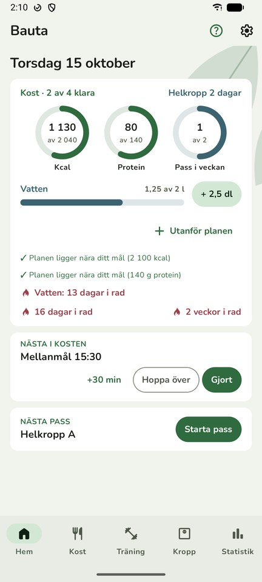
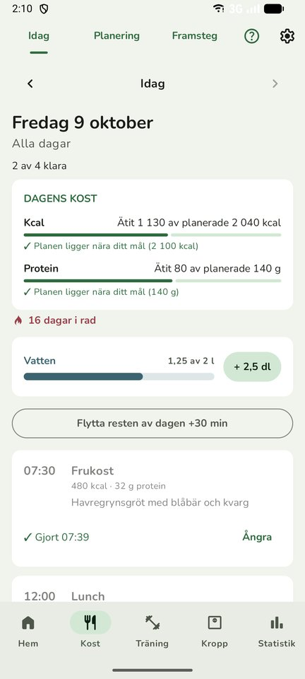
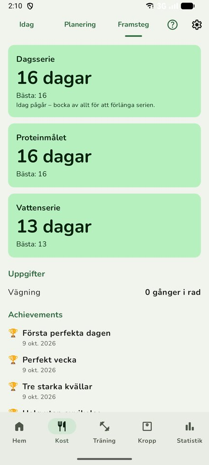
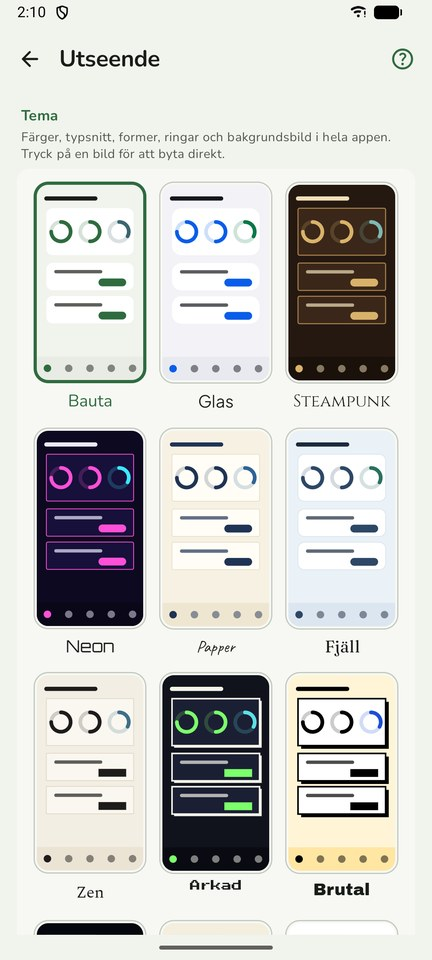

<h1 align="center">Steadfast</h1>

<b>Kost och träning, en dag i taget · Food and training, one day at a time</b> 
Gratis Android-app · Free Android app · Inget konto · No account · Ingen reklam · No ads · Ingen spårning · No tracking

<a href="https://github.com/kakelakel/steadfast-app/releases/latest"><b>⬇ Ladda ner / Download</b></a> ·
<a href="https://kakelakel.github.io/steadfast-app/">Webbsida / Website</a> ·
<a href="https://kakelakel.github.io/steadfast-app/privacy/">Integritet / Privacy</a>

## Svenska

Steadfast hjälper dig att hålla fast vid en plan du själv har valt – för måltider, rutiner och träning. Inte en diet, och ingen app som säger vad du ska äta.

- **Kost:** planera veckan med dagtyper, måltider och tider. Bocka av, eller flytta 30 minuter direkt i notisen. Näringsvärden från Livsmedelsverket.
- **Träning:** pass och program, över 120 övningar, set för set med vilotimer och personbästa.
- **Framsteg utan press:** serier enligt "missa aldrig två gånger i rad". Aldrig belöning för snabb viktnedgång.
- **Vardagen:** vatten, steg, vikt, mått och blodtryck. Widgetar och tolv teman.
- **Din data är din:** allt sparas bara i telefonen. Export och daglig säkerhetskopia till en mapp du väljer.

**Installera:** ladda ner `steadfast.apk` från [senaste versionen](https://github.com/kakelakel/steadfast-app/releases/latest) på telefonen, tillåt webbläsaren att installera appar och tryck Installera. Android 8 eller senare.

**Uppdateringar automatiskt:** lägg till `https://github.com/kakelakel/steadfast-app` i [Obtainium](https://github.com/ImranR98/Obtainium).

**Kontrollera filen:** varje version har sin SHA-256 i versionens text. Alla versioner är signerade med samma nyckel, fingeravtryck (SHA-256):
`10:46:A0:6B:B2:C1:25:EF:F9:24:18:29:5E:C4:73:23:24:24:25:C0:E1:B9:94:86:23:08:D0:B0:FE:85:DF:66`

## English

Steadfast helps you stick to a plan you chose yourself – for meals, routines and training. Not a diet, and not an app that tells you what to eat. Available in Swedish and English.

- **Nutrition:** plan your week with day types, meals and times. Check off, or move 30 minutes straight from the notification. Nutrition data from the Swedish Food Agency.
- **Training:** workouts and programs, 120+ exercises, set by set with rest timer and personal bests.
- **Progress without pressure:** streaks built on "never miss twice". Never rewards rapid weight loss.
- **Everyday:** water, steps, weight, measurements and blood pressure. Widgets and twelve themes.
- **Your data is yours:** everything stays on your phone. Export and daily backup to a folder you choose.

**Install:** download `steadfast.apk` from the [latest release](https://github.com/kakelakel/steadfast-app/releases/latest) on your phone, allow your browser to install apps, and tap Install. Android 8 or later.

**Automatic updates:** add `https://github.com/kakelakel/steadfast-app` in [Obtainium](https://github.com/ImranR98/Obtainium).

**Verify the file:** each release lists its SHA-256. All versions are signed with the same key – certificate fingerprint above.

---

Steadfast är gratis att använda men inte öppen källkod. Den ger inga medicinska råd och är gjord för vuxna, 18 år och äldre.
Steadfast is free to use but not open source. It gives no medical advice and is made for adults aged 18 and over.

© 2026 skaparen av Steadfast. Gratis för privat bruk – se [villkoren](LICENSE). / Free for personal use – see the [terms](LICENSE).

Kontakt / contact: [steadfasttheapp@gmail.com](mailto:steadfasttheapp@gmail.com)
